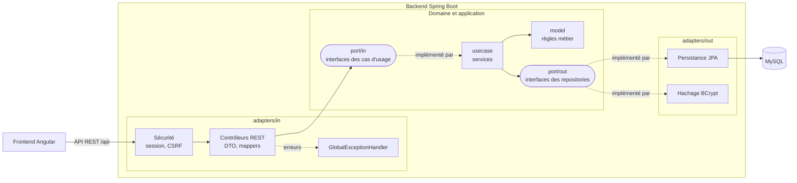

# Journal — Argos (ALTN72, 2026-27)

**Groupe :** Juba LOUDAHI, Matthieu JUIN

Le nom Argos vient d'Argos Panoptès, le géant aux cent yeux de la mythologie grecque qui surveillait tout. On trouvait que ça collait bien à une application de supervision. Le logo est un « A » aux couleurs de l'appli (bleu nuit et orange).

## README

### Application déployée

- Application : https://argos-rd5f.onrender.com
- Swagger : https://argos-rd5f.onrender.com/api/swagger-ui.html

L'application est hébergée sur Render, qui est relié à notre dépôt GitHub. À chaque push sur `main`, Render rebuild et redéploie l'application automatiquement. Le backend est construit avec le `Dockerfile` présent dans `Argos-backend`.

### Comptes de test

| Profil | Login | Mot de passe |
|---|---|---|
| Responsable d'exploitation | `responsable` | `Argos2026!` |
| Agent de terrain | `agent` | `Argos2026!` |

Les mots de passe sont stockés hachés avec BCrypt, jamais en clair.

### Prérequis

- Java 25
- Maven (ou le wrapper `mvnw` fourni dans le projet)
- MySQL 8
- Node.js 22 et npm pour le frontend

### Configuration

Aucun mot de passe n'est écrit dans le code. La connexion à la base passe par des variables d'environnement :

- `DB_URL` (par défaut `jdbc:mysql://localhost:3306/app`)
- `DB_USER` (par défaut `root`)
- `DB_PASSWORD` (vide par défaut)
- `PORT` (par défaut `8080`)

### Initialiser la base

Il faut seulement créer la base une fois :

```sql
CREATE DATABASE app;
```

Ensuite, à chaque lancement du backend, Hibernate recrée les tables (`ddl-auto: create`) et Spring exécute les scripts SQL qui sont dans `src/main/resources` :

- `data.sql` : les deux comptes de test
- `network.sql` : les 72 stations avec leurs coordonnées et les lignes 1, 2 et 4
- `equipment.sql` : environ 350 équipements
- `provider.sql` : 5 prestataires
- `incident.sql` : une quarantaine d'incidents (ouverts, affectés, résolus, évalués)

Pour remettre la base à zéro, il suffit donc de relancer le backend.

Les dates des incidents sont générées par rapport à l'heure actuelle (par exemple `NOW() - INTERVAL 47 HOUR`), comme ça les cas limites marchent quel que soit le jour de la démo. On a des incidents non affectés ouverts depuis 47 h (vert), 48 h (orange), 71 h (orange) et 72 h (rouge).

### Lancer l'application

Backend :

```bash
cd Argos-backend
./mvnw spring-boot:run
```

Frontend :

```bash
cd Argos-frontend
npm install
npm start
```

L'application est ensuite accessible sur http://localhost:4200 et le Swagger sur http://localhost:8080/api/swagger-ui.html. Pour tester l'API depuis Swagger, il faut d'abord se connecter avec `POST /auth/login`.

### Limites connues

- La base est recréée à chaque redémarrage. C'est pratique pour la démo, mais pour une vraie production il faudrait garder les données (avec Flyway par exemple).
## ARCHITECTURE

- Dépôt : https://github.com/theMatuvu/Argos
- Le dépôt contient deux projets : `Argos-backend` (Spring Boot) et `Argos-frontend` (Angular).

### Technologies

- Backend : Java 25, Spring Boot 4.1 (Web, Data JPA, Security, Validation), Lombok
- Base de données : MySQL
- Documentation de l'API : springdoc-openapi (Swagger)
- Frontend : Angular 21, Leaflet pour la carte, ECharts pour les graphiques
- Déploiement : Docker et Render

### Schéma

On a choisi une architecture hexagonale (ports et adaptateurs). L'idée est que le domaine (les règles métier) ne dépende ni de Spring, ni de JPA. Le domaine définit des interfaces (les ports) et ce sont les adaptateurs (REST, base de données, sécurité) qui les implémentent.



Les principaux packages :

- `domain.model` : les objets métier (Incident, Equipment, Provider...) et les règles de gestion
- `domain.exception` : nos exceptions personnalisées
- `domain.port.in` / `domain.port.out` : les interfaces
- `application.usecase` : un service par cas d'usage
- `adapters.in.rest` : les contrôleurs, les DTO et la gestion des erreurs
- `adapters.out.persistance` : les entités JPA, les repositories et les adaptateurs

On a mis un petit fichier `description.md` dans chaque package pour expliquer son rôle, ça nous a aidés à rester d'accord sur où mettre quoi.

Par exemple, pour résoudre un incident : `IncidentController` appelle `ResolveIncidentUseCase`, implémenté par `ResolveIncidentService`, qui appelle `Incident.resolve()` (c'est là que RG5 est vérifiée), puis enregistre via `IncidentRepositoryPort`.

Côté frontend, le code est rangé par fonctionnalité (`dashboard`, `incidents`, `equipments`, `network`, `statistics`...).

## TESTS

### Stratégie

On a écrit des tests unitaires, rangés comme le code :

- Tests du modèle (`domain.model`) : comme les règles sont dans le domaine et ne dépendent pas de Spring, on peut les tester directement sans base de données. C'est là qu'on vérifie la plupart des règles de gestion.
- Tests des services (`application.usecase`) avec Mockito : on remplace les ports `port/out` par des mocks. On vérifie ce que le service renvoie, mais aussi ce qu'il enregistre : dans les cas d'erreur, on vérifie avec `verify(..., never()).save(...)` que rien n'a été écrit.
- Pour les seuils de 48 h et 72 h, on injecte une `Clock` dans les services au lieu d'utiliser `LocalDateTime.now()`, ce qui permet de fixer l'heure dans les tests.

Pour ne pas recréer les mêmes objets dans chaque test, on a une classe `TestData` qui fournit une heure fixe (`NOW`, le 5 novembre 2026 à 9 h), l'horloge qui va avec (`fixedClock()`) et des incidents prêts à l'emploi dans chaque état : `activeIncident`, `assignedIncident`, `resolvedIncident` et `evaluatedIncident`.

On a aussi utilisé deux outils de JUnit 5 :

- `@ParameterizedTest` pour tester plusieurs valeurs avec un seul test, par exemple les seuils d'attention ou les bornes de la note ;
- `@Nested` pour regrouper les tests de `Incident` par thème (création, statut, durées, niveau d'attention, cycle de vie, évaluation).

Les noms des tests décrivent le comportement attendu, par exemple `refusesToResolveAnIncidentTwice` ou `leavesTheEquipmentOutOfServiceWhileAnotherIncidentIsActive`.


Commande :

```bash
cd Argos-backend
./mvnw verify
```

### Ce qui est couvert

Il y a 29 classes de test : 11 pour le modèle et 18 pour les services.

**Règles de gestion :**

| Règle | Ce qu'on vérifie | Tests |
|---|---|---|
| RG1 | un incident déclaré est rattaché à son équipement, ouvert à l'heure actuelle et sans prestataire ; l'équipement passe hors service | `IncidentTest`, `DeclareIncidentServiceTest` |
| RG2 | le statut est non affecté, affecté ou résolu selon l'état de l'incident | `IncidentTest` |
| RG3 | vert jusqu'à 47 h 59, orange à 48 h pile et jusqu'à 71 h 59, rouge à partir de 72 h | `IncidentTest`, `LoadDashboardServiceTest` |
| RG4 | un incident affecté depuis 10 jours a le niveau « affecté » et pas rouge | `IncidentTest`, `LoadDashboardServiceTest` |
| RG5 | la résolution ne peut pas être avant l'ouverture (mais peut être à la même heure) ; un incident résolu ne peut plus être affecté ni résolu une deuxième fois | `IncidentTest`, `ResolveIncidentServiceTest`, `AssignProviderServiceTest` |
| RG6 | un incident résolu n'a plus de niveau d'attention et passe dans les incidents passés de son équipement | `IncidentDetailsTest`, `ResolveIncidentServiceTest`, `EquipmentDetailsTest` |
| RG7 | l'historique est trié par date de résolution, du plus récent au plus ancien ; les incidents d'un équipement par date d'ouverture | `ListResolvedIncidentsServiceTest`, `FindProviderDetailsServiceTest`, `FindEquipmentDetailsServiceTest` |
| RG8 | on ne peut évaluer qu'un incident résolu, avec un prestataire, une seule fois, et avec une note de 1 à 5 | `IncidentTest`, `RatingTest`, `EvaluateIncidentServiceTest` |
| RG10 | quand une opération est refusée (incident introuvable, déjà résolu...), le service s'arrête avant d'écrire quoi que ce soit | tests des services |

Pour RG3, on a testé en minutes et pas en heures (2879 min = 47 h 59, 2880 min = 48 h pile), pour être sûrs que la couleur change exactement au bon moment.

**Fonctionnalités du socle :**

- Consultation : équipements d'une station (F2), fiche d'un équipement avec ses incidents en cours et passés (F3), détail d'un incident avec sa durée d'ouverture (F5).
- Cycle de vie : déclaration (F4), modification de la description, refusée une fois l'incident résolu (F6), affectation et réaffectation (F7), résolution qui remet l'équipement en service seulement s'il n'a plus d'autre incident en cours (F8), évaluation enregistrée avec la date actuelle (F10).
- Tableau de bord (F11) : incidents actifs du plus ancien au plus récent, compteurs (non affectés, affectés, équipements hors service) et liste des incidents résolus en attente d'évaluation.
- Ressource inexistante : chaque service lance la bonne exception (`IncidentNotFoundException`, `EquipmentNotFoundException`, `ProviderNotFoundException`...) quand l'identifiant n'existe pas. C'est cette exception que le `GlobalExceptionHandler` transforme en 404.
- Utilisateurs : le mot de passe est haché avant d'être enregistré, un login déjà utilisé est refusé, et le hash n'apparaît jamais dans un `toString()`.

**Lot alpha :**

- Cartographie (`LoadNetworkMapServiceTest`, `StationTest`) : chargement des stations et des lignes, refus des coordonnées GPS hors des bornes.
- Statistiques (`LoadStatisticsServiceTest`, `NetworkStatisticsTest`) : la courbe contient bien les 30 jours, même ceux sans incident ; le comptage par niveau d'attention garde les niveaux à 0 ; délai moyen de résolution par type d'équipement ; note moyenne ; les 8 stations les plus touchées.
- Surveillance des prestataires (`ProviderSurveillanceTest`, `ProviderSurveillanceCalculatorTest`, `AssignProviderServiceTest`, `ListProvidersServiceTest`) : moyenne des 5 dernières notes, mise sous surveillance en dessous de 3, tri des évaluations même quand deux notes ont la même date, incidents non évalués ignorés, affectation refusée sans confirmation (et rien n'est enregistré) et acceptée sinon. Un test paramétré reprend plusieurs séries de notes avec la moyenne et le résultat attendus.

### Ce qui n'est pas encore couvert

On n'a pas écrit de tests qui ont besoin de Spring ou d'une base de données :

- **Les contrôleurs et le `GlobalExceptionHandler`** : on vérifie que les services lancent la bonne exception, mais pas que l'API renvoie vraiment une 404, une 409 ou une 400. Il faudrait des tests avec `MockMvc` (les dépendances `spring-boot-starter-webmvc-test` et `spring-boot-starter-security-test` sont déjà dans le `pom.xml`).
- **Les droits par profil (RG11)** : pour la même raison, la 403 renvoyée à un agent qui essaie d'affecter un prestataire n'est pas testée automatiquement.
- **Les requêtes des repositories** : dans les tests des services, les repositories sont des mocks, donc les requêtes JPQL et la requête native ne sont pas testées. Par exemple, le fait qu'un incident résolu disparaisse du tableau de bord (RG6) repose sur la condition `where incident.resolvedAt is null` de `findAllActive`. Il faudrait des tests `@DataJpaTest`, avec H2 ou Testcontainers.
- **L'unicité de la référence d'un équipement (RG9)** : elle est garantie par la contrainte `unique` de la colonne en base, donc elle demanderait aussi un test avec une vraie base.
- **Le frontend Angular** : il n'a pas de tests automatisés. Comme toutes les règles métier sont dans le backend, c'est là qu'on a mis la priorité.

## CHOIX TECHNIQUES

### Droits par profil

| N° | Fonctionnalité | Responsable d'exploitation | Agent de terrain |
|---|---|---|---|
| F2–F3 | Consulter équipements et fiches | Accès complet | Accès complet |
| F4 | Déclarer un incident | Accès complet | Accès complet |
| F5–F6 | Consulter / modifier un incident | Accès complet | Accès complet |
| F7 | Affecter ou réaffecter un prestataire | Accès complet | Lecture seule |
| F8 | Déclarer un incident résolu | Accès complet | Lecture seule |
| F9 | Consulter l'historique | Accès complet | Accès complet |
| F10 | Évaluer un prestataire | Accès complet | Lecture seule |
| F11 | Tableau de bord | Accès complet | Accès complet |

L'agent de terrain est celui qui voit les pannes sur place, donc il peut déclarer un incident et modifier sa description. Par contre, affecter un prestataire, clôturer un incident et noter un prestataire, ce sont des décisions du responsable. Seul le responsable peut aussi créer des comptes utilisateurs.

Pour F6, on a décidé que seule la description est modifiable, et seulement tant que l'incident n'est pas résolu. L'équipement et la date d'ouverture ne sont pas modifiables, sinon ça fausserait le calcul du niveau d'attention et l'historique.

Les restrictions sont appliquées côté serveur dans `SecurityConfig` avec `hasRole("OPERATIONS_MANAGER")`. Si un agent appelle directement l'API pour affecter un prestataire, il reçoit une 403. Côté front on cache aussi les boutons, mais c'est juste pour l'affichage.

### Pourquoi Angular et pas Thymeleaf

On a choisi de faire le front en Angular plutôt qu'en Thymeleaf. On a plus l'habitude de travailler avec des frameworks JavaScript, et on trouve la syntaxe plus agréable. Ça permet aussi d'avoir une interface plus fluide : les filtres, les onglets ou la carte se mettent à jour sans recharger la page, ce qui est important pour un tableau de bord. Enfin, comme le front passe uniquement par l'API REST, l'API est utilisée et testée en permanence.

L'inconvénient, c'est qu'on a dû gérer nous-mêmes certaines choses, comme le CSRF avec une SPA, et qu'il y a deux projets à lancer.

### Exceptions

On a choisi `@RestControllerAdvice` (notre classe `GlobalExceptionHandler`) plutôt que `ResponseStatusException`. Avec `ResponseStatusException`, il aurait fallu mettre des codes HTTP directement dans les services ou le modèle, alors que notre domaine ne doit pas dépendre du web. Là, le domaine lance simplement ses propres exceptions et c'est le handler qui choisit le code HTTP.

Nos exceptions héritent de deux classes :

- `ResourceNotFoundException` (incident, équipement, prestataire introuvable...) → 404
- `BusinessRuleException` (incident déjà résolu, déjà évalué, note invalide...) → 409

Les erreurs de validation renvoient une 400. Les réponses sont au format `ProblemDetail`, avec un message en français que le front affiche à l'utilisateur. On n'a pas utilisé `ResponseEntity` car chaque endpoint renvoie toujours le même code en cas de succès, `@ResponseStatus` suffisait.

### SOLID

Principes appliqués :

- **Responsabilité unique (S)** : on a un service par cas d'usage (`DeclareIncidentService`, `ResolveIncidentService`, `EvaluateIncidentService`...) au lieu d'un gros `IncidentService`. Les mappers, le modèle et les services ont chacun leur rôle.
- **Ségrégation des interfaces (I)** : chaque cas d'usage a sa propre interface dans `port/in`, et chaque contrôleur ne dépend que de ce qu'il utilise.
- **Inversion des dépendances (D)** : les services dépendent des interfaces `port/out` et pas directement de JPA. Grâce à ça, on peut tester les services avec des mocks, sans base de données.
- **Ouvert/fermé (O)** : pour ajouter une nouvelle erreur, on crée juste une sous-classe de `ResourceNotFoundException` ou `BusinessRuleException`, sans modifier le handler.

Principe écarté :

- **Liskov (L)** : notre modèle utilise surtout des records et peu d'héritage, donc on n'a pas vraiment de hiérarchie où ce principe s'applique. On n'a pas voulu ajouter de l'héritage juste pour l'illustrer.

### Requêtes

Dans les repositories, on utilise :

- des requêtes dérivées : `findByUsername`, `existsByUsername`, `countByOperatingStatus`...
- des requêtes JPQL : par exemple pour charger les incidents avec leur équipement et leur station (`join fetch`) ou compter les incidents par type d'équipement ;
- une requête SQL native.

### Requête SQL native

Elle se trouve dans `IncidentJpaRepository.findMostAffectedStations` et sert à afficher les stations avec le plus d'incidents sur la page Statistiques.

```sql
SELECT station.name AS stationName, COUNT(incident.id) AS incidentCount
FROM incidents incident
JOIN equipments equipment ON equipment.id = incident.equipment_id
JOIN stations station ON station.id = equipment.station_id
GROUP BY station.id, station.name
ORDER BY incidentCount DESC, station.name
LIMIT :limit
```

Avantages : le calcul est fait directement par la base, et on peut utiliser `LIMIT` simplement.

Inconvénients :

- elle utilise les noms des tables et des colonnes, donc si on renomme un champ dans une entité, la requête ne sera pas mise à jour et l'erreur n'apparaîtra qu'à l'exécution ;
- `LIMIT` n'existe pas dans toutes les bases (Oracle par exemple), donc changer de base obligerait à la réécrire.

Au final, on pense que c'est acceptable ici car c'est une requête de lecture et elle est isolée dans un seul endroit. Mais dans un vrai projet, on préférerait une requête JPQL avec une pagination, qui est vérifiée au démarrage et marche sur toutes les bases.

### @Transactional

On l'utilise à deux endroits, là où une opération modifie plusieurs données :

- `DeclareIncidentService` : on crée l'incident et on passe l'équipement en « hors service ».
- `ResolveIncidentService` : on résout l'incident et on remet l'équipement en service s'il n'a plus d'incident en cours.

Si une des deux écritures échoue, l'autre est annulée, donc les données restent cohérentes (RG10). On ne l'a pas mis ailleurs, car les autres opérations ne modifient qu'une seule ligne, et le `save` de Spring Data est déjà transactionnel.

## LOT ALPHA

Nos deux fonctionnalités principales sont la cartographie du réseau (piste 4) et la visualisation des données (piste 2). On a aussi ajouté une fonctionnalité en plus : la surveillance des prestataires (inspirée de la piste 3).

### Fonctionnalité transverse 1 : cartographie du réseau

**Besoin :** permettre au responsable de voir le réseau sur une carte et d'accéder rapidement aux équipements d'une station.

**Ce qu'on a fait :**

- on a stocké en base les coordonnées GPS réelles des stations (données d'Île-de-France Mobilités) ;
- les lignes sont enregistrées comme une liste de tronçons entre deux stations ;
- le backend renvoie tout le réseau avec `GET /network` ;
- côté front, on affiche la carte avec Leaflet et un fond OpenStreetMap.

**Ce qui fonctionne :** les lignes 1, 2 et 4 avec leurs couleurs, les correspondances, la possibilité d'afficher ou masquer une ligne, et au clic sur une station un lien « Voir les équipements ». La carte est sur le tableau de bord, à côté de la liste des incidents.

**Difficultés :** au début on voulait faire un plan dessiné en SVG, mais c'était trop long à faire, donc on est passé à Leaflet. On a aussi eu un problème de carte qui s'affichait mal quand la taille de la page changeait, qu'on a réglé en recalculant la taille de la carte quand son conteneur change.


### Fonctionnalité transverse 2 : visualisation des données

**Besoin :** le tableau de bord montre la situation à l'instant présent, mais pas l'évolution. On voulait pouvoir voir les tendances et comparer les équipements et les prestataires.

**Ce qu'on a fait :** une page Statistiques avec :

- des indicateurs : incidents actifs, incidents ouverts sur 30 jours, délai moyen de résolution, note moyenne ;
- une courbe des incidents ouverts et résolus sur les 30 derniers jours ;
- un graphique en anneau des incidents actifs par niveau d'attention ;
- des classements : incidents par type d'équipement, délai de résolution par type, stations les plus touchées, note des prestataires.

Côté backend, on a un service `LoadStatisticsService` exposé sur `GET /statistics`. Certains calculs sont faits par la base (une requête JPQL avec `group by` et la requête native), d'autres dans le service, comme le niveau d'attention, pour réutiliser la même règle que le tableau de bord. Côté front, on utilise la bibliothèque ECharts, qu'on a préférée à Chart.js pour ses animations.

**Difficultés :** au départ on avait trop peu d'incidents résolus dans nos données et les graphiques étaient vides ou presque, donc on a ajouté des incidents répartis sur les 30 derniers jours. On a aussi dû générer tous les jours de la période dans le service, sinon les jours sans incident n'apparaissaient pas sur la courbe.

**Reste à faire :** pouvoir choisir la période (pour l'instant c'est toujours 30 jours).

### Fonctionnalité supplémentaire : surveillance des prestataires

Un prestataire est mis « sous surveillance » quand la moyenne de ses 5 dernières notes est inférieure à 3. Dans ce cas, si le responsable veut lui affecter un incident, l'application lui demande de confirmer. Sans confirmation, l'API renvoie une 409. Un badge est aussi affiché sur la liste et la fiche des prestataires.

La règle est dans le modèle (`ProviderSurveillance`). La difficulté principale était de trier correctement les évaluations quand deux notes ont la même date : on trie aussi par identifiant pour avoir toujours le même résultat.

## BILAN

### Contribution de chacun

On a tous les deux touché à presque toutes les parties du projet, et on a relu le code de l'autre avec les pull requests sur GitHub. Chacun s'est quand même davantage occupé de certaines parties :

- **Juba LOUDAHI** : mise en place de l'architecture, connexion et sécurité (F1), cycle de vie des incidents (F4 à F9), structure du front, cartographie, page Statistiques, Swagger.
- **Matthieu JUIN** : modèle de données et persistance, évaluation des prestataires (F10), tableau de bord (F11), écrans prestataires et détail d'incident, surveillance des prestataires et ses tests, déploiement sur Render.

Les données de démonstration, les tests et ce journal ont été faits ensemble.

### Plus grande difficulté

La plus grande difficulté a été de faire marcher la connexion entre Angular et Spring Security. Par défaut, Spring Security redirige vers une page de login HTML, ce qui ne marche pas avec une application Angular. Ensuite, une fois connectés, toutes nos requêtes POST et PUT étaient bloquées par la protection CSRF.

On a d'abord pensé à désactiver le CSRF, mais on a compris que ce n'était pas une bonne idée avec une connexion par session. Finalement :

- la connexion renvoie juste un code (204 si c'est bon, 401 sinon) au lieu de rediriger ;
- Spring envoie le jeton CSRF dans un cookie qu'Angular relit et renvoie dans chaque requête ;
- si le serveur répond 401, le front renvoie vers la page de connexion.


### Trois points à retenir

1. Mettre les règles métier dans le modèle et injecter les dépendances (comme la `Clock`) rend le code beaucoup plus facile à tester.
2. Gérer les exceptions à un seul endroit permet d'avoir des réponses d'erreur claires et cohérentes dans toute l'API.
3. Les restrictions doivent être faites côté serveur : cacher un bouton ne suffit pas à sécuriser une application.